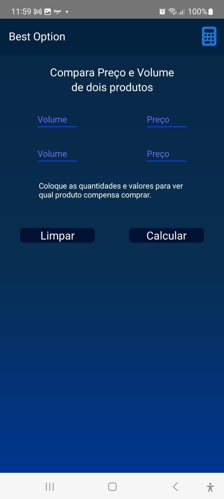
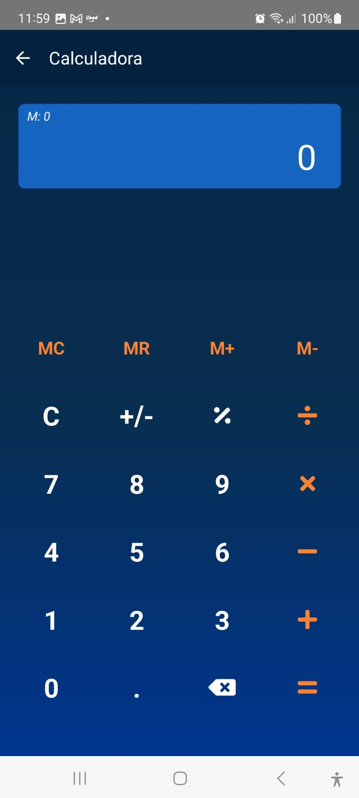

# Best Option (React Native)

Comparador simples para identificar a melhor opção de compra entre dois produtos equivalentes com tamanhos/quantidades diferentes. Ajuda o usuário a decidir pela embalagem com melhor custo-benefício.

— Android e iOS — React Native 0.80 — Node 18+

## Índice
- Visão geral
- Stack e estrutura
- Requisitos
- Início rápido
- Android (debug e release)
- iOS
- Geração de ícone Android (SVG)
- Testes e lint
- Dúvidas comuns (Troubleshooting)
 - Changelog e Playbook

## Visão geral
- Interface com duas áreas principais: Best Option e Calculadora.
- Navegação via `@react-navigation/stack` com `react-native-gesture-handler` e `react-native-reanimated`.
- Ícones FontAwesome.

### Screenshots

Android




### Demo

GIF curto de uso do app:


Para substituir ou adicionar novas imagens, salve-as em `assets/screenshots/` (JPEG/PNG) e o GIF em `assets/demo/demo.gif`.
Se quiser incluir iOS mais tarde, adicione arquivos `ios-*.png|jpeg` e/ou crie uma subseção aqui.

## Stack e estrutura
```
index.js                # AppRegistry
App.js                  # <NavigationContainer />
src/
  navigation/Stack.js   # Stack Navigator
  components/
    bestoption/*        # UI "Best Option"
    calculator/*        # UI Calculadora
android/ ios/           # projetos nativos
__tests__/              # testes Jest (ex.: App.test.tsx)
```

## Requisitos
- Node >= 18, npm
- Android Studio (SDK/Emulador) e/ou Xcode + CocoaPods (macOS)

## Início rápido
```
npm install
npm start                 # inicia Metro bundler
npm run android           # instala em device/emulador Android
# ou
npm run ios               # instala no simulador iOS (macOS)
```

## Android

### Debug (USB)
Com o celular conectado e Depuração USB ativa:
```
./run_android.sh
```
O script:
- verifica ADB e devices autorizados;
- aplica `adb reverse tcp:8081 tcp:8081` (USB);
- inicia o Metro (com `--reset-cache` se necessário);
- instala/abre o app.

Para rodar via Wi‑Fi (sem USB), deixe Metro ativo e no Dev Menu do app defina “Debug server host & port” como `SEU_IP:8081`.

### Release (offline, sem Metro)
Gera e instala um build de release com bundle embutido. Ideal para usar sem USB nem Wi‑Fi:
```
# opção 1: atalho completo
./run_android_release.sh

# opção 2: scripts npm
npm run android:assembleRelease
npm run android:installRelease
```
Os scripts já definem `GRADLE_USER_HOME=.gradle-cache` para evitar erros de permissão do Gradle.

O APK fica em `android/app/build/outputs/apk/release/app-release.apk`.

## iOS (macOS)
```
cd ios && pod install && cd ..
npm start
npm run ios
```
Para rodar em dispositivo físico, abra `ios/BestOptionV3.xcworkspace` no Xcode, configure “Signing & Capabilities” e dê Run.

## Geração de ícone Android (SVG)
O ícone principal está em `best_option_icon.svg` na raiz do projeto.
Para gerar os PNGs em todas as densidades (`mipmap-*`):
```
npm run icons:android
```
Isso sobrescreve `ic_launcher.png` e `ic_launcher_round.png` nas pastas `android/app/src/main/res/mipmap-*`. O `AndroidManifest.xml` já referencia `@mipmap/ic_launcher`.

## Testes e lint
```
npm test        # Jest (preset react-native)
npm run lint    # ESLint
```

## Dúvidas comuns (Troubleshooting)
### “Unable to load script” (porta 8081)
- Certifique-se de que a Metro está rodando: `npx react-native start --reset-cache`.
- USB: o script já aplica `adb reverse tcp:8081 tcp:8081`. Recarregue o app.
- Se preferir Wi‑Fi: defina `SEU_IP:8081` no Dev Menu > Dev Settings.
- Libere a porta se ocupada: `lsof -i :8081` e finalize o processo.
- Limpe build Android: `cd android && ./gradlew clean` e reinstale.

### Erro Gradle “Could not create parent directory for lock file … /opt/gradle/ …”
- Ambiente sem permissão em `/opt`. Use os scripts do projeto (já configuram `GRADLE_USER_HOME=.gradle-cache`).
- Manualmente: `export GRADLE_USER_HOME="$PWD/.gradle-cache"` antes do Gradle.

---

Sinta-se à vontade para abrir issues/PRs com melhorias, bugs ou sugestões.

## Changelog e Playbook
- Changelog: consulte `CHANGELOG.md` para o histórico de alterações.
- Playbook operacional: `docs/MAINTENANCE.md` resume fluxos, scripts e soluções rápidas.
